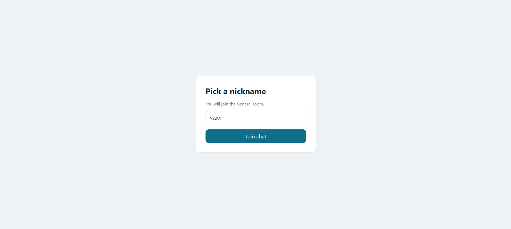
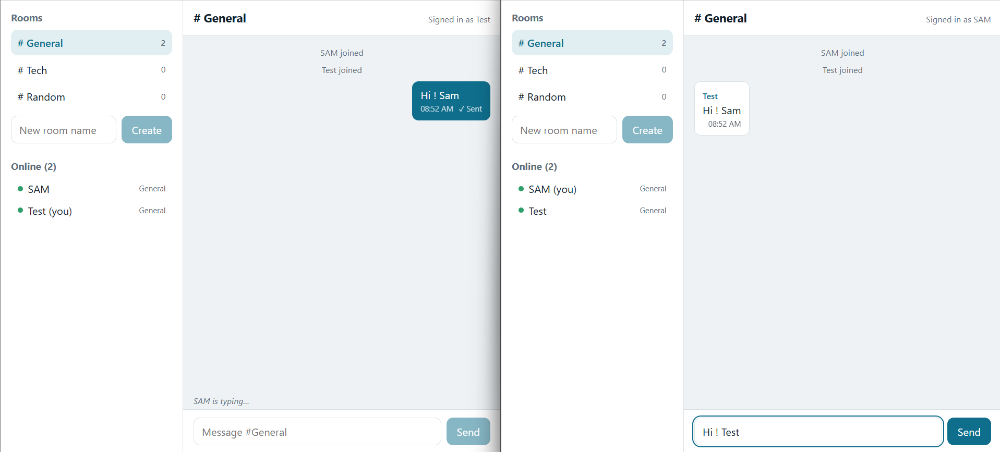

# Real-Time Chat App

Multi-room chat built with Node.js, Express, Socket.io, and React (Vite).
No database. State lives in server memory and resets on restart.

## Features

- Nickname login. Validated and unique (case-insensitive).
- Online users sidebar. Updates live on join and leave.
- Public rooms: General, Tech, Random. Create new rooms. Empty custom rooms are deleted.
- Instant delivery. No page reloads.
- Timestamps on every message.
- Status indicator: Sending, then Sent (server acknowledgement).
- "User is typing…" indicator (debounced).
- Auto-scroll to the latest message.
- Join and leave system messages. Last 100 messages per room are kept.
- Responsive layout.

## Tech

| Layer | Choice |
|---|---|
| Server | Node.js 18+, Express, Socket.io |
| Client | React 18, Vite, socket.io-client |

## Setup

Requires Node.js 18 or newer.

```bash
# Terminal 1: server
cd server
npm install
npm start
```

```bash
# Terminal 2: client
cd client
npm install
npm run dev
```

Open http://localhost:5173 in two browser windows. Use different nicknames.

## Configuration

| Variable | Where | Default |
|---|---|---|
| `PORT` | server | `4000` |
| `CLIENT_ORIGIN` | server | `http://localhost:5173` |
| `VITE_SERVER_URL` | client (`.env`) | `http://localhost:4000` |

Testing over LAN: set `CLIENT_ORIGIN` to the client URL and `VITE_SERVER_URL` to the server URL.

## Socket events

| Event | Direction | Purpose |
|---|---|---|
| `login` | client → server | Register nickname. Ack returns ok or error. |
| `join-room` | client → server | Switch room. Ack returns history. |
| `create-room` | client → server | Create a room. |
| `message` | client → server | Send text. Ack confirms "Sent". |
| `typing` | client → server | Typing start or stop. |
| `message` | server → clients | New message or system message. |
| `typing` | server → clients | Who is typing. |
| `rooms` | server → clients | Room list with member counts. |
| `users` | server → clients | Online users and their rooms. |

## Approach

- Server owns all state. Clients render what the server sends.
- Socket.io rooms scope messages and typing events.
- Acknowledgement callbacks drive the "Sent" status and form validation.
- Sender adds the message optimistically as "Sending". The ack replaces it with the server copy.
- Typing events are debounced (1.5 s) on the client.
- Listeners are removed in `useEffect` cleanup to avoid duplicates.

## Project structure

```
server/index.js            Socket.io server, all events
client/src/App.jsx         State, socket listeners, actions
client/src/socket.js       Socket instance, emitAck helper
client/src/components/     Login, Sidebar, ChatWindow
```

## Screenshots


